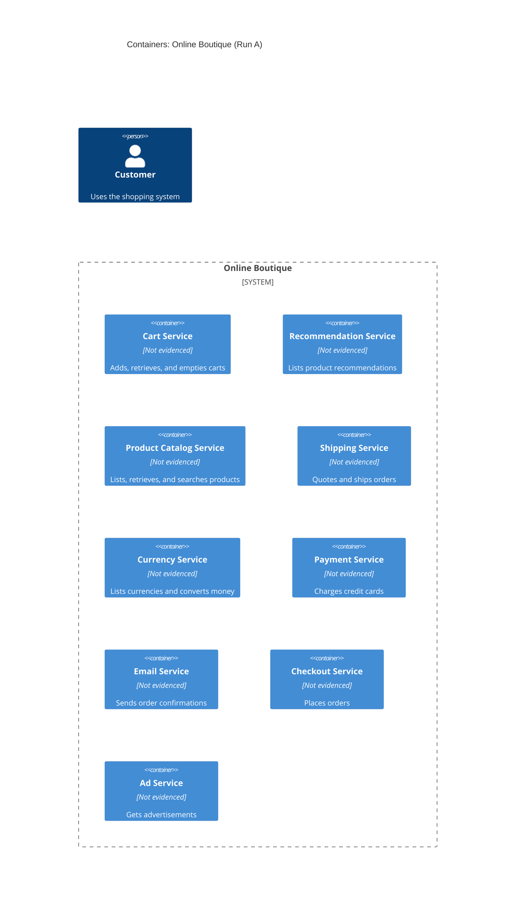

# Run A: Recovered Architecture

## Agent

GitHub Copilot; model: not specified.

## Files read

- `prompts/1-recover-architecture.md`
- `system/online-boutique/protos/demo.proto`

## Containers table

| Name | Technology/language | Responsibility | Evidence |
|---|---|---|---|
| Cart Service | Not evidenced in the provided file | Adds items to a cart, retrieves a cart, and empties a cart | `system/online-boutique/protos/demo.proto` (`service CartService`) |
| Recommendation Service | Not evidenced in the provided file | Lists product recommendations for a user and product context | `system/online-boutique/protos/demo.proto` (`service RecommendationService`) |
| Product Catalog Service | Not evidenced in the provided file | Lists, retrieves, and searches products | `system/online-boutique/protos/demo.proto` (`service ProductCatalogService`) |
| Shipping Service | Not evidenced in the provided file | Gets shipping quotes and ships orders | `system/online-boutique/protos/demo.proto` (`service ShippingService`) |
| Currency Service | Not evidenced in the provided file | Lists supported currencies and converts money amounts | `system/online-boutique/protos/demo.proto` (`service CurrencyService`) |
| Payment Service | Not evidenced in the provided file | Charges a credit card and returns a transaction ID | `system/online-boutique/protos/demo.proto` (`service PaymentService`) |
| Email Service | Not evidenced in the provided file | Sends order confirmation email | `system/online-boutique/protos/demo.proto` (`service EmailService`) |
| Checkout Service | Not evidenced in the provided file | Places an order from user, address, email, and credit-card information | `system/online-boutique/protos/demo.proto` (`service CheckoutService`) |
| Ad Service | Not evidenced in the provided file | Gets advertisements for page context keywords | `system/online-boutique/protos/demo.proto` (`service AdService`) |

## Dependencies table

No runtime dependencies are evidenced in `system/online-boutique/protos/demo.proto`. The file defines service interfaces and message types, but it does not show which service calls another service or identify any caller, callee, or runtime protocol.

## Mermaid diagram

## Gaps

- The implementation language and technology of every service are not determined. A service source directory or build file would settle this.
- No runtime caller-to-callee dependencies can be determined. Service implementations or deployment configuration would show which services call one another.
- The runtime protocol cannot be determined from the service declarations alone. Generated client/server setup or deployment configuration would settle whether these RPCs use gRPC at runtime.
- No data stores are evidenced. Service implementations or deployment configuration would be needed to identify them.
- No external systems, deployment topology, ports, addresses, or service-discovery mechanism are evidenced. Deployment configuration would settle these points.
- The customer is included as the required C4 actor, but the provided file does not evidence the user interface or how the customer reaches any service.
