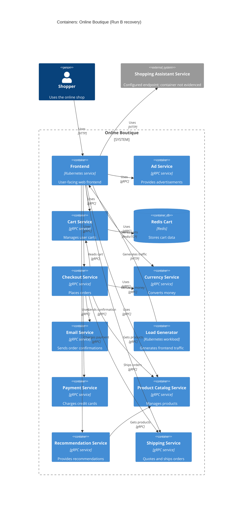

# Recovered architecture: Run B

## Agent

GitHub Copilot; model/version not known.

## Files read

- `prompts/1-recover-architecture.md`
- `system/online-boutique/protos/demo.proto`
- `system/online-boutique/kubernetes-manifests/README.md`
- `system/online-boutique/kubernetes-manifests/kustomization.yaml`
- `system/online-boutique/kubernetes-manifests/adservice.yaml`
- `system/online-boutique/kubernetes-manifests/cartservice.yaml`
- `system/online-boutique/kubernetes-manifests/checkoutservice.yaml`
- `system/online-boutique/kubernetes-manifests/currencyservice.yaml`
- `system/online-boutique/kubernetes-manifests/emailservice.yaml`
- `system/online-boutique/kubernetes-manifests/frontend.yaml`
- `system/online-boutique/kubernetes-manifests/loadgenerator.yaml`
- `system/online-boutique/kubernetes-manifests/paymentservice.yaml`
- `system/online-boutique/kubernetes-manifests/productcatalogservice.yaml`
- `system/online-boutique/kubernetes-manifests/recommendationservice.yaml`
- `system/online-boutique/kubernetes-manifests/shippingservice.yaml`

## Containers table

| Name | Technology/language | Responsibility | Evidence |
|---|---|---|---|
| frontend | Kubernetes service; implementation language not evidenced | User-facing web frontend and entry point to the shop | `frontend.yaml` (`frontend-external`, `PORT`, service addresses) |
| adservice | Kubernetes gRPC service; implementation language not evidenced | Provides advertisements | `demo.proto` (`AdService`); `adservice.yaml` (`port: 9555`) |
| cartservice | Kubernetes gRPC service; implementation language not evidenced | Adds, reads, and empties user carts | `demo.proto` (`CartService`); `cartservice.yaml` (`REDIS_ADDR`) |
| redis-cart | Redis | Stores cart data | `cartservice.yaml` (`image: redis:alpine`, `redis-cart`) |
| checkoutservice | Kubernetes gRPC service; implementation language not evidenced | Places orders | `demo.proto` (`CheckoutService`); `checkoutservice.yaml` (service address environment variables) |
| currencyservice | Kubernetes gRPC service; implementation language not evidenced | Lists currencies and converts money | `demo.proto` (`CurrencyService`); `currencyservice.yaml` (`port: 7000`) |
| emailservice | Kubernetes gRPC service; implementation language not evidenced | Sends order confirmation email | `demo.proto` (`EmailService`); `emailservice.yaml` (`port: 5000`) |
| loadgenerator | Kubernetes workload; implementation language not evidenced | Generates HTTP traffic to the frontend | `loadgenerator.yaml` (`FRONTEND_ADDR`, `wget`) |
| paymentservice | Kubernetes gRPC service; implementation language not evidenced | Charges a credit card | `demo.proto` (`PaymentService`); `paymentservice.yaml` (`port: 50051`) |
| productcatalogservice | Kubernetes gRPC service; implementation language not evidenced | Lists, retrieves, and searches products | `demo.proto` (`ProductCatalogService`); `productcatalogservice.yaml` (`port: 3550`) |
| recommendationservice | Kubernetes gRPC service; implementation language not evidenced | Lists product recommendations | `demo.proto` (`RecommendationService`); `recommendationservice.yaml` (`PRODUCT_CATALOG_SERVICE_ADDR`) |
| shippingservice | Kubernetes gRPC service; implementation language not evidenced | Quotes and ships orders | `demo.proto` (`ShippingService`); `shippingservice.yaml` (`port: 50051`) |

## Dependencies table

| Caller -> Callee | Protocol | Evidence |
|---|---|---|
| loadgenerator -> frontend | HTTP | `loadgenerator.yaml` (`FRONTEND_ADDR=frontend:80`, `wget http://`) |
| frontend -> productcatalogservice | gRPC | `frontend.yaml` (`PRODUCT_CATALOG_SERVICE_ADDR=productcatalogservice:3550`); `productcatalogservice.yaml` (`name: grpc`) |
| frontend -> currencyservice | gRPC | `frontend.yaml` (`CURRENCY_SERVICE_ADDR=currencyservice:7000`); `currencyservice.yaml` (`name: grpc`) |
| frontend -> cartservice | gRPC | `frontend.yaml` (`CART_SERVICE_ADDR=cartservice:7070`); `cartservice.yaml` (`name: grpc`) |
| frontend -> recommendationservice | gRPC | `frontend.yaml` (`RECOMMENDATION_SERVICE_ADDR=recommendationservice:8080`); `recommendationservice.yaml` (`name: grpc`) |
| frontend -> shippingservice | gRPC | `frontend.yaml` (`SHIPPING_SERVICE_ADDR=shippingservice:50051`); `shippingservice.yaml` (`name: grpc`) |
| frontend -> checkoutservice | gRPC | `frontend.yaml` (`CHECKOUT_SERVICE_ADDR=checkoutservice:5050`); `checkoutservice.yaml` (`name: grpc`) |
| frontend -> adservice | gRPC | `frontend.yaml` (`AD_SERVICE_ADDR=adservice:9555`); `adservice.yaml` (`name: grpc`) |
| frontend -> shoppingassistantservice | HTTP, inferred from port 80 | `frontend.yaml` (`SHOPPING_ASSISTANT_SERVICE_ADDR=shoppingassistantservice:80`) |
| cartservice -> redis-cart | Redis/TCP | `cartservice.yaml` (`REDIS_ADDR=redis-cart:6379`); `redis-cart` service (`tcp-redis`) |
| recommendationservice -> productcatalogservice | gRPC | `recommendationservice.yaml` (`PRODUCT_CATALOG_SERVICE_ADDR=productcatalogservice:3550`); `productcatalogservice.yaml` (`name: grpc`) |
| checkoutservice -> productcatalogservice | gRPC | `checkoutservice.yaml` (`PRODUCT_CATALOG_SERVICE_ADDR=productcatalogservice:3550`); `productcatalogservice.yaml` (`name: grpc`) |
| checkoutservice -> shippingservice | gRPC | `checkoutservice.yaml` (`SHIPPING_SERVICE_ADDR=shippingservice:50051`); `shippingservice.yaml` (`name: grpc`) |
| checkoutservice -> paymentservice | gRPC | `checkoutservice.yaml` (`PAYMENT_SERVICE_ADDR=paymentservice:50051`); `paymentservice.yaml` (`name: grpc`) |
| checkoutservice -> emailservice | gRPC | `checkoutservice.yaml` (`EMAIL_SERVICE_ADDR=emailservice:5000`); `emailservice.yaml` (`name: grpc`) |
| checkoutservice -> currencyservice | gRPC | `checkoutservice.yaml` (`CURRENCY_SERVICE_ADDR=currencyservice:7000`); `currencyservice.yaml` (`name: grpc`) |
| checkoutservice -> cartservice | gRPC | `checkoutservice.yaml` (`CART_SERVICE_ADDR=cartservice:7070`); `cartservice.yaml` (`name: grpc`) |

## Mermaid diagram

## Gaps

- The implementation language of every service is not evidenced by the provided proto or Kubernetes manifests. The service source directories or Dockerfiles would settle this.
- `shoppingassistantservice` is referenced by `frontend.yaml`, but no deployment or service manifest for it is included. Its container boundary, implementation, and whether it is enabled are not evidenced. The shopping assistant manifest or frontend source would settle this.
- `loadgenerator.yaml` exists but is commented out in `kustomization.yaml`; therefore its deployment status in this manifest set is uncertain. The Skaffold configuration or an applied deployment manifest would settle this.
- The proto defines service interfaces but does not prove which caller invokes each RPC. The caller source files would settle exact call direction and operation usage.
- The user-facing protocol is not explicitly specified for `frontend-external`; the HTTP relation is inferred from its port name and target port in `frontend.yaml`.